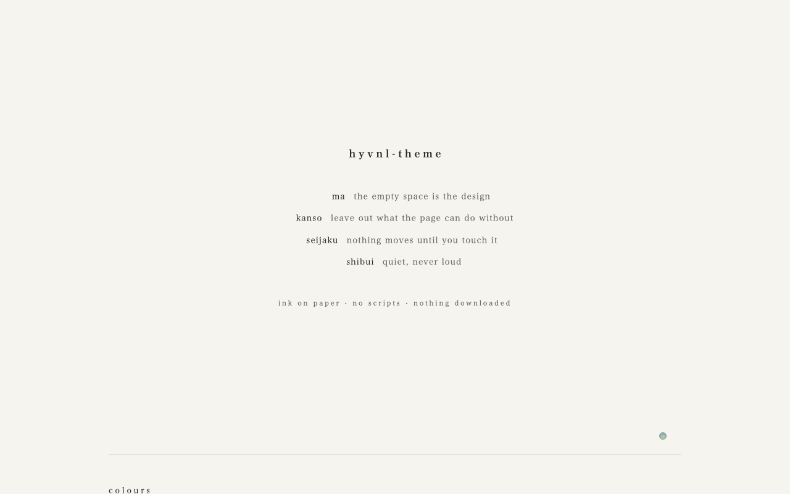
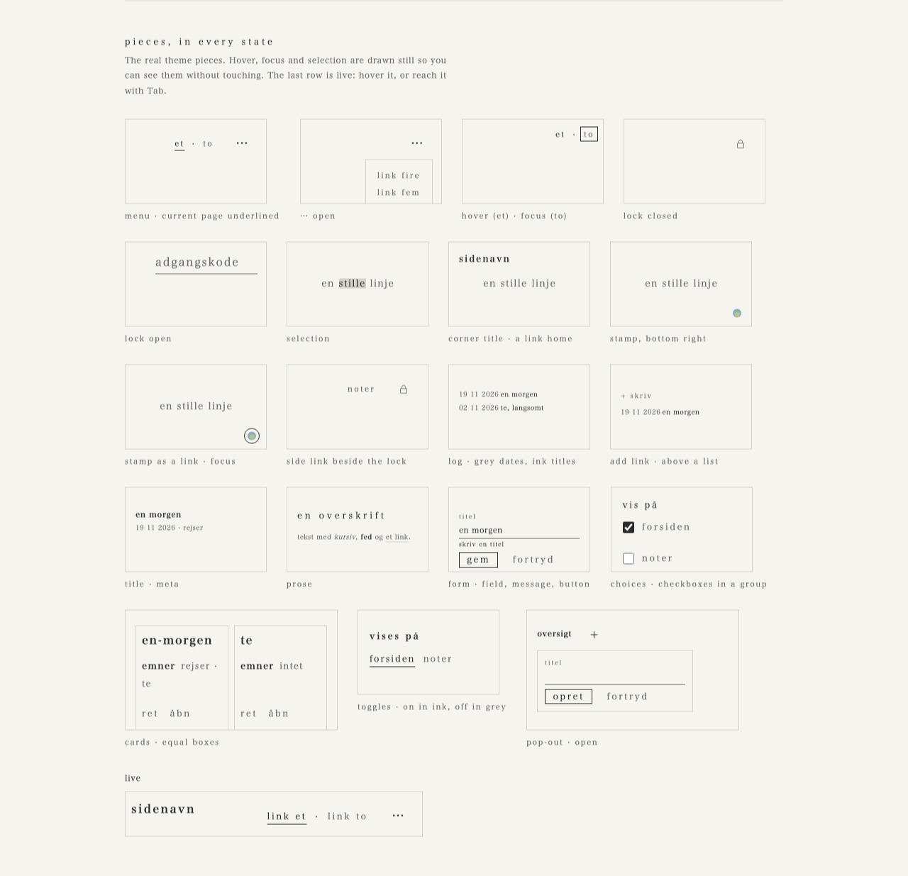
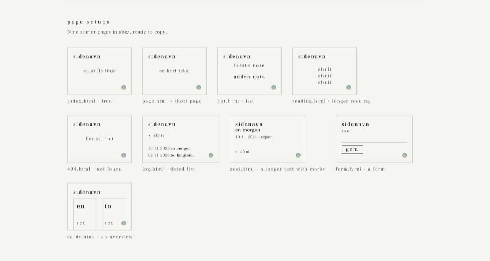
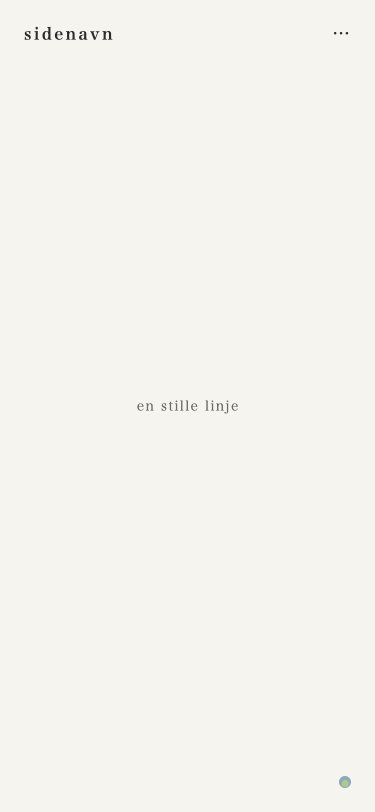

# hyvnl-theme

**ink on paper**

- **ma** — the empty space is the design
- **kanso** — leave out what the page can do without
- **seijaku** — nothing moves until you touch it
- **shibui** — quiet, never loud



The shared look for my websites: one style file, nine starter pages, no scripts, nothing downloaded.







## See it yourself

```bash
python3 -m http.server 8000
```

Then open http://localhost:8000/specimen/ for the whole theme on one page. To click through the starter pages, see `GUIDE.md` section 9.

## Use it

Read `GUIDE.md`. The style file is `site/theme.css`; `site/` is what a new site copies.

Free to use under the MIT licence (see `LICENSE`).
